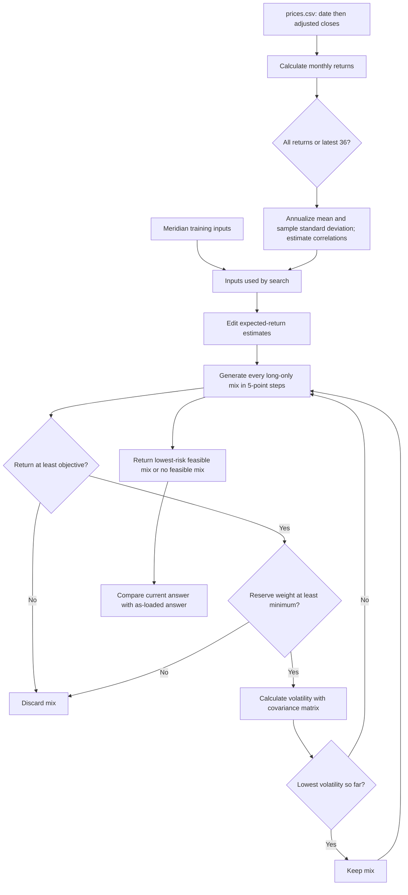

# Lab 15 — Portfolio Stability Decision

## Decision question

Which mix carries the least risk while meeting the mandate—and does the answer survive a one-point change in one estimate?

## AI-use and estimate labels

The app and engine changes were built with AI help as a learning demonstration. They are not investment advice. Meridian uses course-authored training inputs. Any uploaded-price return is a historical annualized estimate from monthly adjusted-close prices, not a forecast.

## Engine flow



## Meridian known-answer validation

| Run | Bills / 10-year / IG / equity | Return | Volatility | Largest weight change |
|---|---:|---:|---:|---:|
| As loaded | 0 / 20 / 25 / 55 | 6.51% | 9.44% | — |
| Equity return 8.0% → 7.0% | 0 / 10 / 10 / 80 | 6.53% | 12.94% | 25 points |

The one-point reduction in the equity estimate moves one quarter of the portfolio. The lowest-risk mix is therefore not stable to this small expected-return change.

For the engine-link check, changing both IG–equity correlation cells from 0.25 to 0.50 changes the answer to **0 / 40 / 0 / 60**, with a **6.52%** return and **9.73%** volatility. Restoring both cells to 0.25 restores the as-loaded result.

## Project 2 universe and sources

The file `Lab15/prices.csv` contains 60 complete months of adjusted-close prices from October 2021 through September 2026, ordered oldest first. The four funds provide one fund for each portfolio role without adding overlapping substitutes.

| Ticker | Fund and mandate role | Price source | Download date |
|---|---|---|---|
| SGOV | iShares 0–3 Month Treasury Bond ETF — cash and reserve | [Yahoo Finance historical data](https://finance.yahoo.com/quote/SGOV/history/) | 2026-10-22 |
| SCHR | Schwab Intermediate-Term U.S. Treasury ETF — government bonds | [Yahoo Finance historical data](https://finance.yahoo.com/quote/SCHR/history/) | 2026-10-22 |
| USIG | iShares Broad USD Investment Grade Corporate Bond ETF — fixed income | [Yahoo Finance historical data](https://finance.yahoo.com/quote/USIG/history/) | 2026-10-22 |
| SPGM | SPDR Portfolio MSCI Global Stock Market ETF — global equity | [Yahoo Finance historical data](https://finance.yahoo.com/quote/SPGM/history/) | 2026-10-22 |

**Mandate objective:** 6.5% expected return.

**Hard constraint:** Reserve-eligible weight must be at least 3%.

**Reserve-eligible assets:** SGOV.

## Project 2 results

| Window | Lowest-risk mix | Expected return | Volatility | Reserve weight |
|---|---|---:|---:|---:|
| All monthly returns | 60% SGOV / 0% SCHR / 0% USIG / 40% SPGM | 6.86% | 6.02% | 60.00% |
| Latest 36 monthly returns | 85% SGOV / 0% SCHR / 0% USIG / 15% SPGM | 6.88% | 1.79% | 85.00% |

**Largest weight change:** 25 percentage points. Changing the estimation window moves 25 points from SPGM into SGOV, even though both mixes meet the same 6.5% objective and 3% reserve minimum.

## Partner attack

**Estimate changed and reason:** In a simulated skeptical-partner test, SPGM's expected return was reduced by one percentage point, from 11.49% to 10.49%, because the historical global-equity return is the most uncertain and may not persist. The all-month mix changed from 60% SGOV / 0% SCHR / 0% USIG / 40% SPGM to 55% SGOV / 0% SCHR / 0% USIG / 45% SPGM; expected return changed from 6.86% to 6.80%, volatility rose from 6.02% to 6.76%, and the largest weight change was 5 percentage points.

**Two-sentence response:** Lowering SPGM's expected return forces the optimizer to hold five points more SPGM because more equity is needed to clear the unchanged 6.5% objective. The counterintuitive increase in both equity weight and volatility shows why a minimum-return optimizer can amplify estimation risk and should be treated as a pilot rather than an automatic allocation.

## My call

**Adopt, pilot, or reject:** Pilot, not adopt. Changing the estimation window moves 25 percentage points from global equity into the reserve fund.

**Condition that would change the call:** Adopt only after the allocation remains reasonably stable across additional estimation periods and historical averages are supplemented with defensible forward-looking estimates.

## Estimation risk

Estimation risk is the chance that portfolio inputs—especially expected returns—differ from the future values they are intended to represent. A grid optimizer compares many portfolios and selects the one that looks best under the supplied estimates; small input errors can change which portfolio barely clears the return objective, causing a large and abrupt weight change. Here, lowering only the equity return estimate from 8.0% to 7.0% moves the largest weight by 25 points, so the optimizer amplifies a one-point estimate change into a major allocation change.

Before adopting the mix, I would need evidence that the return estimates are defensible, tests across additional plausible estimates, and clarification of any mandate constraint that is not encoded in the search.

## Commands

```bash
python portfolio.py
python -m unittest tests.test_portfolio -v
streamlit run Lab15/app.py
```
